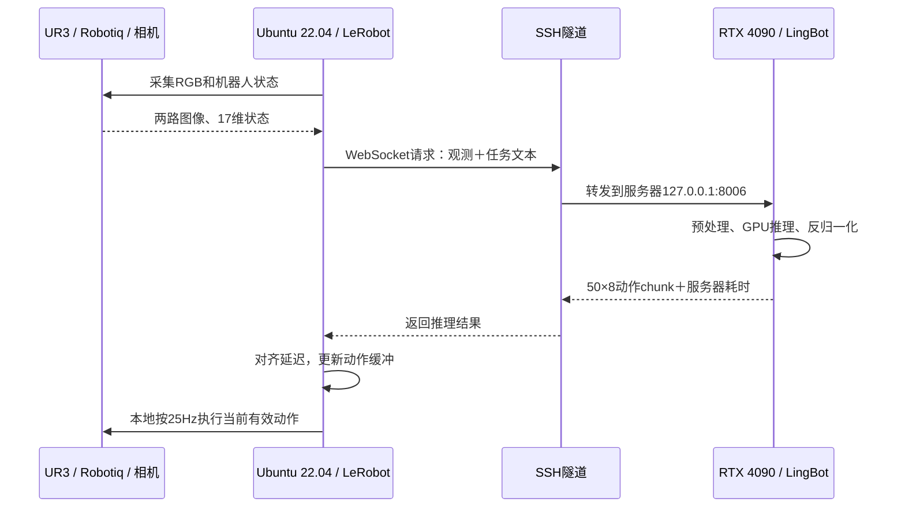

# 4090技术报告：UR3数字积木任务的LingBot-VLA V2训练与真机通信

报告日期：2026-10-23。报告对象：2026-10-17～2026-10-18 完成的第二轮训练，即 **VLM 语言最后四层＋动作专家联合微调、5000 步、每 2500 步保存**。本报告不将后续迁移服务器视为已经完成的新一轮训练。

## 1. 实验目标与主要结论

任务是在 UR3 与 Robotiq 夹爪平台上，根据指令区分数字 0、2、6 积木，完成抓取并放入指定区域。第一轮训练冻结整个 VLM，动作执行出现空抓和位置适应不足；第二轮允许 VLM 高层参与任务适配，并保留原始双相机 640×480 输入。

主要结果如下：

- 在 **4×RTX 4090** 上完成 5000 次 optimizer 更新，约 **2.18 epoch**，从首条带时间戳日志到最后导出约 **25小时24分钟**。
- 训练过程记录完整，数值有限、无跳过 batch；末 100 步总 loss 均值为 **0.111958**。
- 5000 步 checkpoint 在 4159 帧独立验证数据上的平移动作 RMSE 为 **3.709mm**，优于 2500 步的 3.917mm 和不移动基线的 6.110mm；旋转平均误差仍略差于保持姿态基线。
- 新模型在单张 4090 上完成原生 BF16 推理和本机 WebSocket 验证，推理 CUDA allocated 峰值约 **12.35GiB**，预热后单次推理约 **0.79 秒**。
- 后续真机定性反馈仍有选错数字、抓不住以及目标上方悬停。因此，本次已经完成训练与部署可行性验证，**尚未达到可靠的指令条件抓取目标**。

证据分为训练/离线评估实测、用户真机反馈、待确认原因三类；文中的原因分析不替代执行日志或受控实验。

## 2. 数据集信息

### 2.1 数据规模与任务划分

| 项目 | 内容 |
|---|---|
| 数据路径 | `/data-teamA/datasets/ur3_eef_relative_20261016` |
| 数据格式 | LeRobot v3，Parquet 状态/动作数据＋MP4 视频 |
| 轨迹 / 帧数 | 90 条 episode / 40,847 帧 |
| 采集频率 / 总时长 | 25Hz / 约27.23分钟，不按双相机重复计算时长 |
| 每条轨迹帧数 | 最少303帧，中位454帧，最多634帧 |
| 相机 | 全局视角与腕部视角，两路 RGB，原始640×480（宽×高） |
| 视频 | 18个视频文件，编码AV1；视频文件不与episode一一对应 |
| 任务 | 抓取数字0、2、6积木，并放入指定区域 |
| 磁盘数据量 | 约652MiB |

| task_index | 对应目标 | 总episode数 | 训练 / 验证episode数 | 总帧数 |
|---|---|---|---|---|
| 0 | 数字 2 | 30 | 27 / 3 | 13,773 |
| 1 | 数字 0 | 30 | 27 / 3 | 13,637 |
| 2 | 数字 6 | 30 | 27 / 3 | 13,437 |

任务文本分别为 `Pick up block 0 and place it in the square area.`、`Pick up block 2 and place it in the square area.`、`Pick up block 6 and place it in the square area.`。**task_index 不是积木数字编号**，推理端应发送完整任务文本。

### 2.2 训练与验证划分

按完整 episode 划分，避免同一轨迹的帧同时进入训练与验证：

| 划分 | Episode数 | 帧数 | 占episode比例 |
|---|---|---|---|
| 训练集 | 81，每个任务27条 | 36,688 | 90% |
| 验证集 | 9，每个任务3条 | 4,159 | 10% |

随机种子为42，验证 episode 为 `14、15、23、40、44、49、73、74、84`。划分记录在 [ur3_20261016_split_seed42.json](assets/training_data/ur3_20261016_split_seed42.json)。该划分隔离了轨迹，但尚不能证明验证集覆盖了独立的新摆位分布；当前也没有单独的受控真机测试集。

### 2.3 状态、动作与坐标约定

| 输入或输出 | 原始维度及顺序 | 模型内处理 |
|---|---|---|
| `observation.state` | 17维：6关节角、TCP xyz、TCP rotvec、TCP quaternion xyzw、实际夹爪状态 | 使用关节6维＋末端位置/四元数7维＋夹爪1维，共14个有效维度；补齐到55维 |
| `action` | 8维：相对平移xyz、局部相对四元数xyzw、绝对夹爪目标 | 补齐到55维，使用有效动作维度mask |
| 全局图像 | `observation.images.camera_global` | 映射为 `camera_top` |
| 腕部图像 | `observation.images.camera_wrist` | 映射为 `camera_wrist_left` |

平移增量按 base 坐标系解释，旋转增量为局部相对四元数，夹爪为绝对目标。动作已是相对动作，映射中 `subtract_state: false`，不能再减一次当前状态。若驱动接收绝对目标，需按采集约定使用 `p_target = p_current + delta_p`、`q_target = q_current ⊗ delta_q`；执行前对预测四元数单位化。

归一化仅统计训练集，采用 float64 计算均值、总体标准差及分位数，避免验证数据泄漏和四元数小方差的精度损失。状态四元数先单位化，再依据保存的参考四元数选择一致半球；该处理不改变实际姿态，也不需要在推理后“反转符号还原”。

相关文件为 [机器人映射](configs/robot_configs/ur3_robotiq_eef_relative.yaml) 和 [归一化统计](assets/norm_stats/ur3_robotiq_eef_relative_20261016.json)。

### 2.4 数据质量与执行语义检查

数据审计未报告数值/结构问题；视频检查覆盖全部文件元数据，并在每条轨迹每路相机抽取3帧，共540帧。真实数据管线的边界样本、归一化与动作往返映射检查通过。该检查不是所有视频帧的完整损坏扫描，也不构成90条示范全部成功的证明。

存在一项必须保留的语义线索：动作命令的平移范数中位数约 **6.18mm/周期**，实际相邻TCP位移中位数约 **1.58mm/周期**；滞后1帧时两者相关系数约 **0.9935**，最小二乘比例约 **0.254**。这可能与控制增益、平滑、限幅或命令定义有关，必须结合采集/执行驱动确认。**不能仅凭该比例给动作乘以0.25，也不能直接判定标签错误。**

## 3. 模型与训练模式

### 3.1 初始化与可训练范围

使用 `/data-teamA/models/lingbot-vla-v2-6b` 的完整预训练模型初始化，从该起点重新微调，未接续第一轮已训练checkpoint。模型导出张量规模约 **6.376B**，本次可训练参数精确记录为 **2,341,813,815（约23.42亿）**。

本次直接更新选定层的原始参数，未使用LoRA。相关初始化和教师资源如下：

| 资源 | 本机位置与用途 |
|---|---|
| 完整LingBot权重 | `/data-teamA/models/lingbot-vla-v2-6b`，包含VLM与动作侧预训练参数 |
| Qwen配置及processor | `/data-teamA/models/Qwen3-VL-4B-Instruct`；该目录约12MiB，完整VLM参数从LingBot权重加载 |
| MoGe权重 | `/data-teamA/models/MoGe-2-vitb-normal/model.pt` |
| 深度教师 | `/data-teamA/models/lingbot-vla-v2-6b/depth/model.pt`，配合MoGe用于深度监督 |
| 视频特征教师 | `/data-teamA/models/lingbot-vla-v2-6b/dino_video/teacher_step_10000.pth` 及同目录 `config.yaml` |

| 模块 | 本次状态 | 目的 |
|---|---|---|
| Qwen视觉编码器 | 冻结 | 保留预训练基础视觉特征，控制反向传播和优化器开销 |
| 词嵌入、语言层0～31 | 冻结 | 保留大部分预训练表示 |
| 语言层32～35 | 解冻，层索引从0开始 | 允许高层视觉语言表示适配指令与抓取任务 |
| Action Expert | 训练 | 学习基于视觉、语言与机器人状态的动作 |
| State/Action投影与辅助预测头 | 训练 | 适配机器人状态、动作和辅助监督任务 |

本次不是只训练末端的一个线性action head，而是训练完整动作专家及配套模块，并增加VLM最后四层训练。视觉编码器冻结不代表图像不参与推理；但基础视觉特征提取方式在本次训练中保持固定。

冻结与分组学习率由 [ur3_adapters.py](tools/ur3_adapters.py) 的包装逻辑实施，必须通过 `tools/run_ur3.py --stage train --vlm-train-last-layers 4` 启用，不能仅凭 YAML 中 `train_expert_only: false` 认定冻结范围相同。

### 3.2 与第一次训练的关系

| 项目 | 第一次训练 | 本次训练 |
|---|---|---|
| 数据集 | 旧 `ur3_eef_relative` | 新 `ur3_eef_relative_20261016` |
| 训练帧数 | 38,822 | 36,688 |
| VLM | 整体冻结 | 语言最后4层解冻，其他部分冻结 |
| 真实RGB输入 | 256×256，另有无效相机占位 | 640×480，仅两路真实相机 |
| 可训练参数 | 约19.38亿 | 约23.42亿 |
| 路由专家学习率 | 约5.66e-5，带自动倍率 | 显式1e-5，关闭自动倍率 |
| Weight decay | 0 | 0.01，bias/一维参数不衰减 |

两次同时改变了数据、分辨率、相机槽数、学习率和解冻范围，且验证集不同。因此，这不是能单独量化“解冻最后四层”收益的严格消融实验。

### 3.3 学习目标

主任务使用 flow matching 动作学习，按有效动作维度mask计算损失；同时保留当前深度、未来深度、未来视频等辅助监督，以及MoE的sequence-wise和router-z正则。主要辅助权重均为0.004，sequence-wise系数为1e-3，router-z系数为1e-4。

辅助深度/视频教师提供训练监督，其输入与目标网格可以与VLM的RGB输入不同。辅助损失下降不能直接证明模型已经能够识别数字、理解指令或完成物理抓取。

## 4. 硬件与软件环境

| 项目 | 本次环境 |
|---|---|
| 训练GPU | 4×NVIDIA GeForce RTX 4090，每卡标称24GB |
| 训练环境 | Conda `lingbotvla`，`/data-teamA/miniforge3/envs/lingbotvla` |
| Python | 3.12.15 |
| PyTorch / torchvision | 2.8.0+cu126 / 0.23.0+cu126 |
| Transformers / Hugging Face Hub | 4.57.3 / 0.34.3 |
| Flash Attention / TorchCodec | 2.8.3 / 0.6.0 |
| LeRobot | 0.4.2 |
| NumPy / PyArrow | 1.26.4 / 21.0.0 |
| 容器内存上限 | 约200GiB；不能用宿主机总内存代替该限制 |

软件版本依据本次环境记录及报告编写时的包元数据；后续迁移服务器的环境与硬件需单独配置。训练实际使用的注意力路径为 `flex_cached`，不能因环境安装了Flash Attention就将其等同于所有模块均使用Flash Attention。

## 5. 主要训练参数

| 参数类别 | 参数 | 实际值 |
|---|---|---|
| 初始化 | `model_path` | 完整 LingBot-VLA V2 初始模型 |
| 初始化 | `init_device` / `post_training` | `meta` / `true`，分片后严格加载预训练权重 |
| 训练范围 | `train_expert_only` / `freeze_vision_encoder` | `false` / `true`，另由包装参数限定语言最后4层 |
| 并行 | `data_parallel_mode` / `enable_full_shard` | `fsdp2` / `true` |
| 精度 | `enable_mixed_precision` | `true`，BF16 |
| Batch | 每卡micro batch / 梯度累积 / 全局batch | 1 / 4 / 16 |
| 步数 | `max_steps` / `save_steps` | 5000 / 2500 |
| 学习率 | VLM / 动作专家 / 其他投影及辅助头 | 1e-6 / 1e-5 / 2e-5 |
| 调度 | `lr_warmup_ratio` / `lr_decay_style` | 0.03，即150步预热 / constant |
| 优化器 | AdamW betas / eps | (0.9, 0.95) / 1e-8 |
| 正则 | `weight_decay` | 0.01；bias和一维参数为0 |
| 梯度 | `max_grad_norm` | 1.0，日志GradNorm为裁剪前范数 |
| 显存 | 梯度检查点 / activation offload / FSDP CPU offload | 开 / 关 / 关 |
| 编译 | 整模型 `use_compile` | `false` |
| 显存分配 | `PYTORCH_CUDA_ALLOC_CONF` | `expandable_segments:True` |
| 输入 | 相机数 / 图像宽×高 / 图像增强 | 2 / 640×480 / 关闭 |
| 动作 | `chunk_size` / 内部state与action宽度 | 50 / 55维 |
| 数据加载 | `num_workers` | 每rank为2 |
| 文本 | `tokenizer_max_length` | 72 |
| MoE | 层数 / 专家数 / top-k | 36 / 32 / 4 |
| MoE | routed/shared intermediate size | 512 / 704 |
| MoE | router activation / routed scaling | sigmoid / 4.0 |
| MoE | `use_moe_expert_lr` / `bias_update_speed` | `false` / 0 |
| 保存 | DCP / HF / HF异步保存 | 开 / 开 / 关 |
| 其他 | `seed` / `enable_resume` | 42 / `false` |
| 可视化 | `visual_steps` / WandB | 1,000,000，本次不触发周期图像可视化 / 关闭，保留TensorBoard |

配置来源为 [train_two_views_640.yaml](configs/vla/ur3_20261016/train_two_views_640.yaml) 与运行目录下 `lingbotvla_cli.yaml`。VLM/专家的显式学习率来自包装代码，而不是单独由 `train.lr` 定义。

全局batch与epoch关系为：

```text
全局batch = 每卡1 × 4卡 × 累积4 = 16
每epoch步数 = 36,688 / 16 = 2,293
2,500步 ≈ 1.09 epoch；5,000步 ≈ 2.18 epoch
累计使用帧样本约80,000次，含重复采样及重叠动作窗口
```

`num_train_epochs: 29000` 是循环上限，实际由 `max_steps: 5000` 提前停止。50帧动作窗口覆盖约2秒，但相邻窗口重叠，不能把样本量再乘50解释为独立示范数量。

## 6. 训练优化与640×480适配

### 6.1 实际采用的方法

| 方法 | 实现及作用 |
|---|---|
| 局部解冻 | 控制需要梯度和优化器状态的参数范围，保留高层任务适配能力 |
| FSDP2全分片 | 四卡分片参数、梯度和优化器状态；与ZeRO-3的三类状态分片目标相近，本次未叠加DeepSpeed |
| BF16混合精度 | 降低计算与部分激活开销；主权重和优化器状态等仍可能保留FP32，不能将全部显存简单按减半估算 |
| 梯度检查点 | 在反向中重算部分前向激活，以计算换激活显存 |
| micro batch=1＋梯度累积 | 保持全局batch=16，避免单次更大batch的激活峰值 |
| 移除无效相机槽 | 删除始终被mask的右腕占位，保留两路真实观测，减少无效token与计算 |
| 可扩展allocator | 减少碎片和不可复用空间；在Python启动前设置环境变量 |
| 关闭activation offload | 双相机方案可装入显存，减少CPU/GPU传输成本 |
| 关闭整模型compile | 采用已测量的资源基线；底层注意力内核仍可能自行编译 |
| 分组LR、预热、正则与裁剪 | 控制预训练VLM更新幅度，减小训练初期过大更新 |
| 减少重型图像可视化 | 5000步内不触发大图像记录，保留标量与日志 |

### 6.2 非方形分辨率的必要适配

1. 显式支持 `image_height=480`、`image_width=640`，训练与推理共用尺寸解析，覆盖遗留 `img_size=256` 的方形默认值。
2. 按真实图像网格读取辅助头的视觉token；640×480每路图像为300个合并后的token，不能继续固定取64个token。
3. 深度教师保持比例的特征网格可能为14×18，共252个位置；将该监督特征插值到16×16，与预训练头的256个查询匹配。该步骤没有把VLM的RGB输入缩小到256×256。
4. 确保meta初始化后加载完整预训练权重，并检查分片后的参数、buffer及冻结状态，避免以未正确加载的参数开始训练。

### 6.3 显存短跑对照

下表均为4卡、640×480，每rank完成6个optimizer step；耗时取排除前两步后的中位数。相机“三槽”指两路真实图像加一个无效占位。

| 方案 | CUDA allocated峰值/GiB | reserved峰值/GiB | 驱动采样峰值/GiB | 最小采样余量/MiB | 秒/步 |
|---|---|---|---|---|---|
| 三相机槽、最后2层、无 offload | 20.313 | 22.816 | 23.508 | 492 | 21.782 |
| 三相机槽、最后4层、activation offload | 18.729 | 21.943 | 22.637 | 1384 | 29.113 |
| 双相机、最后4层、默认 allocator | 20.076 | 22.736 | 23.430 | 572 | 17.834 |
| 双相机、最后4层、可扩展 allocator（采用） | 19.972 | 21.895 | 22.588 | 1434 | 18.119 |

相对于“三槽＋最后4层＋activation offload”，最终组合方案单步耗时由29.113秒降到18.119秒，减少约 **37.8%**。这是相机槽、offload和allocator的组合对比，不能将全部收益归给单一开关；可扩展allocator相对双相机默认allocator主要改善显存余量，没有显示更快的短跑速度。

驱动数据按1秒采样，可能漏掉短峰值。短跑使用weight decay=0，正式训练为0.01；短跑未执行checkpoint序列化，也不是完整保存/恢复验收。最终长训的CUDA峰值与保存结果见下一节。

## 7. 正式训练结果

### 7.1 完整性、耗时与显存

| 项目 | 实际结果 |
|---|---|
| 首条带时间戳日志 | 2026-10-17 14:25:48 |
| 最后HF导出完成 | 2026-10-18 15:49:41 |
| 日志覆盖总时长 | 25小时23分53秒，约25.40小时 |
| 稳定单步耗时 | 排除前150步后的中位数 **18.158秒** |
| Optimizer step | 1～5000连续完整 |
| 训练数值 / 忽略batch | 解析到的指标均有限 / 0 |
| 四rank完成记录 | 齐全，均记录max_steps=5000 |
| 正式训练单卡CUDA峰值 | allocated约19.972GiB，reserved约21.898GiB |
| CPU及驱动全程峰值 | 没有同等完整的持续峰值记录，不以短跑或宿主机数据代替 |

以上时间按日志原样记录，原日志行未标注时区；不能直接与其他服务器的显示时间混用。记录的总时长包含初始化、训练及导出。正式训练速度与18.119秒短跑接近，早期26～28小时是预估，最终应以约25.40小时实测为准。

### 7.2 训练损失

| 指标 | 开始阶段 | 结束阶段 |
|---|---|---|
| 单步总loss | 第1步 1.2322 | 第5000步 0.1088 |
| 单步VLA loss | 第1步 1.2010 | 第5000步 0.1052 |
| 100步平均总loss | 前100步 0.741434 | 后100步 0.111958 |
| 100步平均VLA loss | 前100步 0.725050 | 后100步 0.108301 |
| 原始深度loss | 第1步 3.3789 | 第5000步 0.2413 |
| 原始未来深度loss | 第1步 3.2005 | 第5000步 0.2610 |
| 原始未来视频loss | 第1步 0.7482 | 第5000步 0.0377 |

后100步相较前100步平均总loss下降约 **84.9%**。最大记录梯度范数为47.4892，属于裁剪前值，不表示超过阈值的梯度未经处理。loss下降说明训练目标被优化，但由于缺少连续独立验证loss曲线，不能仅据此判断泛化或排除过拟合。


图中同时展示原始日志与100步移动均值；辅助损失使用日志中的未乘主要权重数值。虚线标记保存步数。该图由本次日志生成，未使用第一次训练的旧曲线；`StepTime`是训练器定义的计时，不代表含网络传输等部署耗时。

### 7.3 参数更新与模型导出

严格加载检查确认初始state/action投影、动作专家及VLM抽检参数与初始模型匹配。训练后将初始模型转换到BF16再与checkpoint比较：第0层抽检q-proj无变化，第32层q-proj、第35层k-proj及state/action投影有变化。这支持局部解冻确实生效，但抽检不是所有参数的逐一审计。

2500和5000步均成功保存DCP与HF权重；每份HF导出含1708个BF16张量，数据约11.876GiB，分片索引和长度一致，两个模型均已严格加载用于独立评估。训练末尾5000步HF导出被执行两次，最终文件有效。

日志汇总 `hf_failed: 0`，但出现 `eval_failed: 3`。代码会将“HF成功、评估未提交且未标记跳过”的记录计入该字段，不能据此认定模型评估或导出失败；本报告的独立评估由单独脚本实际完成。

DCP与HF保存已完成，但没有完整记录证明执行过中断后恢复训练的实验；不能把成功保存等同于恢复链路也已验证。

## 8. 独立验证结果与指标解释

### 8.1 评估方法

对2500/5000步使用相同9条验证轨迹、4159帧，共88次查询。每次输入真实观测，预测50帧动作；使用BF16、10次去噪、compile=false、按查询固定随机种子，排除轨迹尾部padding。

- 平移RMSE为平移误差向量的均方根：`1000 × sqrt(mean(||pred_xyz - true_xyz||²))`，单位mm。
- 旋转使用四元数单位化后的测地角，并处理q与-q等价性：`2 × acos(abs(dot(q_pred, q_true)))`，换算为度。
- 夹爪MAE沿用采集数据的数值单位，不是长度单位。
- 基线动作为零平移、单位局部旋转，并将夹爪保持在每个chunk起始观测值。

### 8.2 Checkpoint与基线对比

| 模型 | 平移RMSE/mm | 旋转均值/° | 旋转P95/° | 夹爪MAE |
|---|---|---|---|---|
| 2500 步 | 3.917 | 0.2757 | 1.5153 | 0.03749 |
| 5000 步 | 3.709 | 0.2314 | 1.4653 | 0.03715 |
| 保持不动基线 | 6.110 | 0.2003 | 1.6648 | 0.12240 |

5000步的平移RMSE相对2500步降低约 **5.3%**，相对保持不动基线降低约 **39.3%**；夹爪MAE相对基线降低约 **69.6%**。因此在这两份候选中，选择5000步作为首个部署实验模型。

旋转平均误差0.2314°仍高于基线0.2003°，而P95略好于基线。不能笼统称所有动作分量都已全面优于基线。

### 8.3 5000步模型按任务汇总

| 任务 | 验证episode数 | 有效帧数 | 平移RMSE/mm | 旋转均值/° | 夹爪MAE |
|---|---|---|---|---|---|
| 抓取数字 0 | 3 | 1,382 | 3.697 | 0.1451 | 0.04337 |
| 抓取数字 2 | 3 | 1,538 | 3.902 | 0.2615 | 0.03298 |
| 抓取数字 6 | 3 | 1,239 | 3.467 | 0.2902 | 0.03540 |

以上按帧数加权汇总，平移RMSE按各轨迹平方误差重新聚合，未直接平均RMSE。它们衡量给定任务与观测后的动作误差，**不是数字分类准确率或正确目标选择率**。

3.709mm不是末端到目标物体的真实定位误差；该离线实验也没有将预测动作闭环执行，因此不能换算为抓取成功率。

## 9. 推理部署与LeRobot对接

### 9.1 单卡实测

测量条件为本次5000步模型、两路640×480、batch=1、chunk=50、BF16、10次去噪、compile=false。推理不运行训练用深度/视频教师的监督计算。

| 指标 | 实测 |
|---|---|
| 推理设备 | 单张RTX 4090 |
| 模型参数占用 | 约11.876GiB |
| CUDA allocated / reserved峰值 | 12.354 / 12.395GiB，不含全部驱动开销 |
| 专项测试首次调用 | 1.624秒，不含初始化 |
| 预热后9次推理中位 / P95 | 0.789 / 0.801秒，排除3次预热 |
| 完整验证集推理中位 / P95 | 0.796 / 0.818秒 |
| 本机WebSocket三任务调用 | 约0.793～0.798秒 |
| 输入 / 输出检查 | healthz、reset、双图像＋17维状态＋文本输入及有限50×8动作返回通过 |
| 请求数据量 | 1,843,555字节，约1.84MB，原始双RGB数组未压缩 |

现有完整BF16权重本身已超过8GB，所以普通8GB显卡不能用当前整模型驻留GPU的加载方式运行。16GB显卡有容量可行性，但具体速度与显存余量尚未实测；4090单卡方案已测量。没有完成量化或CPU卸载推理适配。

### 9.2 部署位置与两端分工

本项目采用“**Ubuntu 22.04 真机电脑运行 LeRobot，RTX 4090 服务器运行 LingBot-VLA V2**”的分离部署。Ubuntu版本由用户提供；这里说明已确定的通信协议和对接方式，真机端具体驱动与调度实现仍以其实际代码为准。

| 位置 | 框架/组件 | 职责 |
|---|---|---|
| 本机Ubuntu 22.04 | LeRobot及自定义机器人适配器 | 读取相机和17维机器人状态，组织任务文本，管理动作缓冲，调用硬件接口执行动作 |
| 本机Ubuntu 22.04 | WebSocket客户端与SSH客户端 | 将观测发给服务器，接收动作chunk；网络调用放在独立工作线程中 |
| RTX 4090服务器 | LingBot-VLA V2推理服务 | 加载5000步权重，完成预处理、GPU推理和动作反归一化，通过8006端口返回结果 |
| UR3、Robotiq和相机 | 硬件与驱动 | 执行控制命令，持续提供图像和实际状态反馈 |

完整模型部署在服务器，真机端无需加载LingBot权重。LeRobot和LingBot通过明确的数据接口交互，不依赖共享Python进程或同一Conda环境；这套接口由项目适配代码连接，并非两个框架自动互通。

### 9.3 通信链路：WebSocket＋MessagePack＋SSH隧道

| 层次 | 本项目采用的方式 |
|---|---|
| 应用交互 | 持久WebSocket连接上的观测请求与动作响应 |
| 数据序列化 | MessagePack；NumPy数组携带dtype、shape和原始字节，避免将图像转为大量JSON数字 |
| 跨服务器连接 | SSH本地端口转发，将真机电脑的8006映射到4090服务器的127.0.0.1:8006 |
| 服务监听 | 启动脚本默认监听127.0.0.1:8006，使用单张4090、BF16、compile=false、返回50步动作 |
| 客户端访问 | 真机端连接 `ws://127.0.0.1:8006`；此处的localhost属于真机电脑，经隧道到达服务器 |

4090服务器上的服务入口为：

```bash
cd /home/teamA/lingbot-vla-v2
bash tools/serve_ur3.sh
```

Ubuntu 22.04真机电脑另开终端保持隧道运行。以下沿用此前4090推理服务器的SSH连接信息，区别于后续迁移训练使用的新服务器：

```bash
ssh -p 30044 -N -L 8006:127.0.0.1:8006 teamA@183.147.142.40
```

其中30044是SSH端口，8006是推理服务端口。`ws://`通信位于SSH加密隧道内；SSH转发负责传输，模型请求与动作响应仍按WebSocket协议处理。



序列图描述单次交互；持续运行时，真机本地控制与网络推理应独立调度。该图不代表已经取得完整真机控制日志。

### 9.4 观测输入与动作返回格式

| 方向 | 字段 | 形状/类型与含义 |
|---|---|---|
| 真机→服务器 | `observation.images.camera_global` | RGB uint8，480×640×3，全局相机 |
| 真机→服务器 | `observation.images.camera_wrist` | RGB uint8，480×640×3，腕部相机 |
| 真机→服务器 | `observation.state` | float32，17维，按第2.3节的关节、TCP及夹爪顺序排列 |
| 真机→服务器 | `task` | 完整任务文本，例如 `Pick up block 0 and place it in the square area.` |
| 服务器→真机 | `action` | float32，50×8，已反归一化的未来动作序列 |
| 服务器→真机 | `server_timing.infer_ms` | 服务端 `policy.infer` 调用耗时，单位毫秒 |

每条8维动作依次为 **base坐标系平移增量xyz、局部旋转增量四元数xyzw、绝对夹爪目标**。服务器返回机器人数据单位下的动作，真机端不应再次做mean/std反归一化；若硬件驱动要求绝对TCP，则由真机适配器按采集时约定转换，并对预测四元数单位化。

客户端连接后先接收服务器metadata，再执行 `reset("ur3_robotiq_eef_relative")`，其请求内容为 `{"reset": true, "robo_name": "ur3_robotiq_eef_relative"}`。该操作加载机器人映射、归一化信息并清理服务端缓存，**不执行机械臂回零或物理复位**。随后持续发送观测，调用 `infer(observation)` 取得动作。

`task_index`不随意替代任务文本：新数据0→数字2、1→数字0、2→数字6。指令传递应贯穿采集、客户端和服务器，记录最终实际输入文本，避免将编号错误误判为模型不理解指令。

### 9.5 一次请求在服务器中的处理

1. WebSocket服务接收二进制消息，恢复NumPy图像、状态和任务文本。
2. 按训练配置处理双路640×480图像；对UR3状态四元数单位化并统一半球，执行归一化、有效维度映射和文本/图像编码。
3. 在4090上运行VLM与动作专家，按当前10次去噪设置预测50步动作；辅助教师不参与推理监督计算。
4. 将模型内部55维动作还原为机器人8维动作，执行反归一化，返回 `action` 和服务器计时。
5. 真机侧接收后管理动作缓冲，根据实际驱动接口进行必要的坐标/姿态转换并执行；硬件控制调用始终在Ubuntu真机端完成。

协议代码位于 [WebSocket客户端](deploy/websocket_client_policy.py)、[WebSocket服务端](deploy/websocket_policy_server.py) 和 [NumPy序列化](deploy/msgpack_numpy.py)；模型服务位于 [LingBot推理入口](deploy/lingbot_vla_v2_policy.py)。真机端可复用或适配该客户端协议，无需复制整个训练环境。

### 9.6 本地25Hz控制与异步推理

现有 `WebsocketClientPolicy.infer()` 本身是“发送一次、等待一次返回”的同步调用。将其放入真机端独立工作线程，才能在网络等待期间继续本地控制；服务器使用异步WebSocket库，也不会自动让机械臂控制循环变成异步。

| 本机执行单元 | 应承担的工作 |
|---|---|
| 观测采集与推理工作线程 | 获取最新图像/状态，保存本机观测时间，发送请求并等待结果 |
| 本地控制循环 | 每40ms读取当前有效动作并调用驱动，不等待单次网络推理 |
| 动作缓冲与调度 | 结合请求时间和实际已执行步数，对齐新旧chunk，处理过期动作、缓冲不足和任务切换 |

25Hz周期为40ms，而当前单次服务器推理约790ms，约跨越20个控制周期，另有网络与采集耗时。50步覆盖2秒，不意味着应盲执行完整2秒，也不意味着只需不断取新chunk前几帧；正确的消费和重规划规则必须由真机端实现。

当前基础协议没有自动完成跨机器时钟同步、动作时间戳回传或延迟补偿，客户端需要自行管理请求与观测时间，不能把此处的调度要求写成已经实现并验收的功能。

`server_timing.infer_ms`包含服务端预处理、模型调用及反归一化等 `policy.infer` 范围，不包含完整网络往返。端到端延迟应由真机端对一次 `infer()` 调用独立计时；两者之差还包含序列化、排队和传输等开销，不能直接当作纯网络RTT。可选字段 `prev_total_ms`也不应直接当作网络RTT。

### 9.7 通信实测范围与当前限制

2026-10-18的loopback测量已覆盖三种任务的连接、reset、观测和有限动作返回，约0.793～0.798秒；未提供同样格式的Ubuntu真机电脑到4090服务器的远程端到端时延记录。后续已有真机定性反馈，仍没有受控成功率和同步执行日志。

基准使用未压缩RGB数组，每次请求约1.84MB。10Mbps有效上传时纯上传下限约1.47秒，叠加约0.79秒推理便可能超过2秒窗口。当前服务端代码另有可选deflate扩展，是否实际使用取决于启动设置与客户端协商；不能把基准数据解释为压缩后的网络性能。

本报告列出的延迟来自2026-10-18评估时的代码与配置；后续入口和通信代码整理没有重新进行同等性能测试。以上命令和流程仅作为报告中的部署说明，本次文档更新未连接机器人、启动服务或执行控制。

## 10. 真机反馈、问题归纳与待确认原因

### 10.1 已有定性反馈

| 用户观察 | 对应问题 | 当前证据边界 |
|---|---|---|
| 夹爪向木块方向移动，但抓不住 | 接近行为存在，完整抓取未完成 | 不能由接近行为证明识别和精确定位正确 |
| 指令要求0，却抓取2或6 | 指令条件下的目标选择不可靠 | 尚未区分文本/编号传递问题与模型语义问题 |
| 到木块上方某个高度停止 | 接近到下探抓取阶段的闭环停滞 | 尚无同步动作和TCP日志定位停滞位置 |

这些是真机使用反馈，目前没有提供受控试验次数、目标选择准确率或完整成功率，不编造量化结果。

### 10.2 优先排查路径

1. **指令链路**：记录客户端发出的文本与服务器收到的文本，确认未把task_index直接当作数字标签，也未仅传与训练格式不同的裸数字。
2. **动作链路**：同时记录模型原始动作、缩放/限幅后的最终下发动作、实际TCP与夹爪状态。若模型不再预测下降，调查策略和观测；若模型预测下降而下发归零，调查客户端过滤；若下发下降而TCP不动，调查驱动、IK与执行限制。
3. **时序与chunk消费**：检查是否存在过期动作、缓冲不足、重复接近段或持续丢弃下探阶段的问题。
4. **观测分布**：确认相机顺序、RGB/BGR、视角、光照、机器人初始姿态和状态字段与训练一致。
5. **模型与数据**：在链路核对后，对相近起始状态、变化目标位置与变化指令做受控对照；若仍缺乏正确目标响应，再评估摆位覆盖、末段示范和视觉语言适配范围。

“VLM高层语义绑定不足”“数据位置先验”“执行端高度限制”都属于待验证原因；不能仅凭现象确定某一项，也不能认为增加步数或进一步解冻视觉编码器就必然有效。

## 11. 训练产物、备份与迁移

### 11.1 本次训练产物

训练根目录为：`/data-teamA/outputs/ur3_20261016/train_two_views_640_last4_seed42`。

| 产物 | 内容 |
|---|---|
| `checkpoints/global_step_2500/`、`global_step_5000/` | 各自包含DCP模型、optimizer、extra_state及HF导出 |
| `hf_ckpt/` | 供推理加载的完整BF16权重 |
| `lingbotvla_cli.yaml` | 实际训练配置，现有推理加载器依赖上级目录中的该文件 |
| `train.log`、`runs/` | 完整日志、TensorBoard标量 |
| `completed_rank*.json` | 各rank完成记录与CUDA峰值 |
| `weight_load_rank*.json` | 预训练加载及冻结范围检查记录 |

每份完整checkpoint约53GiB，其中HF约11.88GiB；DCP还包含模型及优化器状态。两份正式结果合计约107GiB，推理部署不能将整个训练目录大小等同于GPU显存需求。

### 11.2 备份与跨服务器迁移记录

- **2026-10-18备份**：5000步完整训练产物及配套资料备份到 `/data-teamA/outputs_back/ur3_20261016/train_two_views_640_last4_seed42`，179个文件约53.15GiB，逐文件SHA-256与源文件匹配。
- **2026-10-21迁移**：向 `/zeron-vepfs/tj/openwam/lingbotvla/lingbot-vla-v2-real-experiments` 复制数据、初始LingBot、深度/视频教师、MoGe与Qwen配置，并增加4个远端专用配置文件；145个文件约27.34GiB均通过SHA-256校验。
- 远端目录包含 `datasets/`、`models/`、`outputs/` 和已有代码目录 `lingbot-vla-v2/`。迁移记录证明文件一致性；该次操作保留本机文件，未安装远端环境、未启动训练。
- 迁移时确认代码快照为 `f74fc46`，其时间晚于本次训练，不能当作2026-10-17启动训练时的原始commit。原训练可复现依据主要是保存的实际配置、适配逻辑、权重与日志；未提供训练时完整代码版本快照。

## 12. 结论与后续工作

本次证明了 **4卡4090上采用640×480双相机、VLM语言最后四层与动作专家联合微调的工程可行性**，并获得了可严格加载、可单卡服务的5000步模型。训练损失明显降低，5000步的离线平移和夹爪指标优于保持不动基线，且总体优于2500步候选。

任务效果仍有明确不足：真机指令区分和抓取末段没有形成可靠闭环，旋转平均离线误差也未优于保持姿态基线。后续优先补齐端到端日志与执行约定核查，再用新摆位、不同指令的受控试验测量目标选择率和抓取成功率。确认执行链路一致后，才对数据覆盖、训练时长或视觉侧解冻做单变量对照。

## 附录A：本机训练启动方式

以下为本次训练参数的复现入口，不会在生成报告时执行。需先激活本次环境并设置已有离线缓存、动态库路径等环境项。

```bash
cd /home/teamA/lingbot-vla-v2
export CUDA_VISIBLE_DEVICES=0,1,2,3
export OMP_NUM_THREADS=1
export PYTORCH_CUDA_ALLOC_CONF=expandable_segments:True

python -u -m torch.distributed.run --standalone --nproc_per_node=4 \
  tools/run_ur3.py --stage train \
  --manifest assets/training_data/ur3_20261016_split_seed42.json \
  --vlm-train-last-layers 4 \
  configs/vla/ur3_20261016/train_two_views_640.yaml \
  --train.max_steps 5000 --train.save_steps 2500
```

新训练应使用新的 `train.output_dir`，避免与已完成结果混用。该命令不构成对任意新硬件和新环境的显存/依赖保证。

## 附录B：主要证据索引

| 内容 | 原始记录或配置 |
|---|---|
| 数据规模、动作范围、视频抽样、语义线索 | [数据审计JSON](docs/ur3_20261016_data_audit.json) |
| 实际划分与归一化 | [训练划分](assets/training_data/ur3_20261016_split_seed42.json)、[归一化统计](assets/norm_stats/ur3_robotiq_eef_relative_20261016.json) |
| 正式训练参数 | [训练YAML](configs/vla/ur3_20261016/train_two_views_640.yaml)、运行目录 `lingbotvla_cli.yaml` |
| 训练完成、损失与导出 | [训练汇总](docs/ur3_20261016_training_result.json)、运行目录 `train.log` |
| 局部解冻参数变化 | [参数抽检](docs/ur3_20261016_checkpoint_parameter_check.json) |
| 显存与耗时短跑对比 | [显存测量JSON](docs/ur3_640x480_memory_measurement.json) |
| 2500 / 5000步独立评估 | [2500步指标](docs/ur3_20261016_validation_step2500.json)、[5000步指标](docs/ur3_20261016_validation_step5000.json) |
| 单卡推理与本机接口 | [推理测量JSON](docs/ur3_20261016_inference_benchmark.json) |
| 后续真机现象 | 用户反馈；尚未提供相同格式的同步原始执行日志与受控成功率统计 |

本报告由已有数据与实验记录整理，未重新启动训练、推理性能测试或真机动作，也未修改训练代码。
